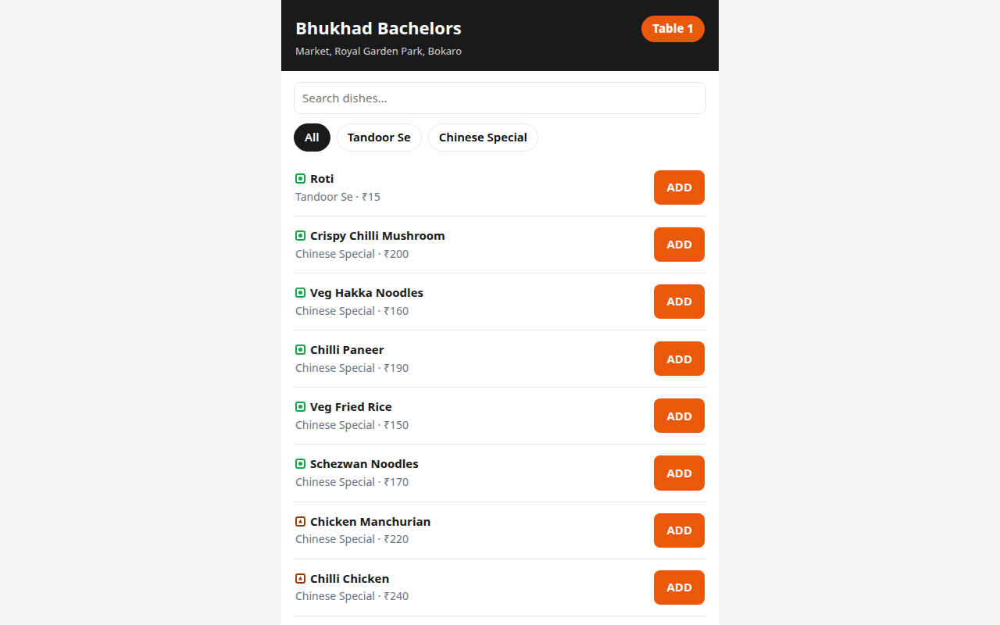
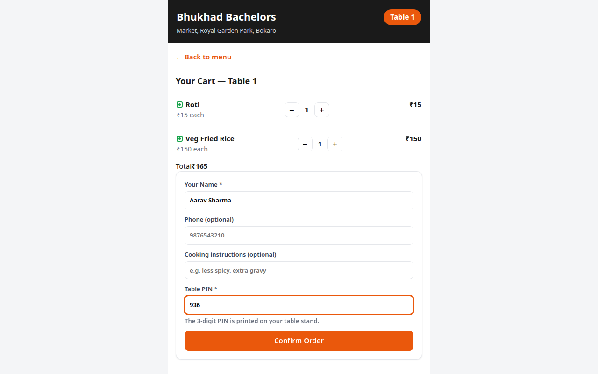
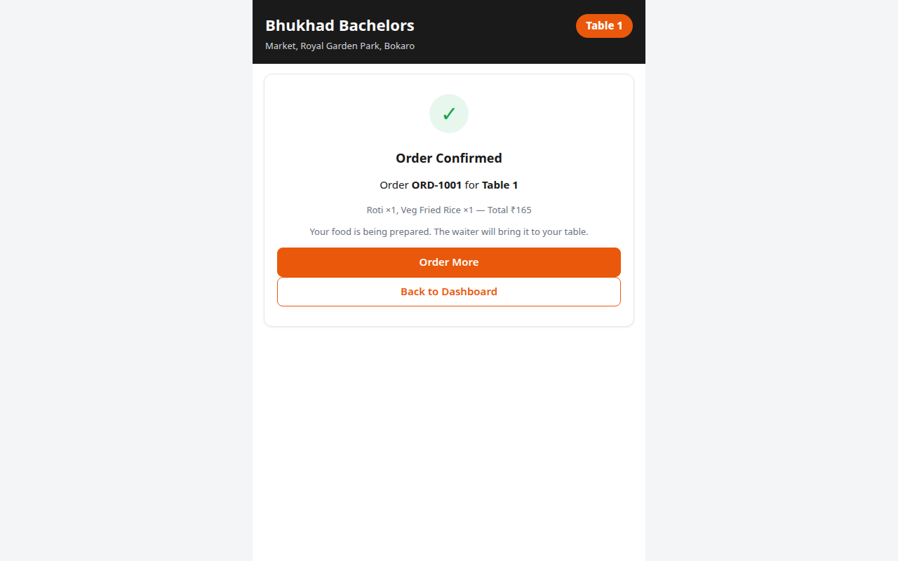
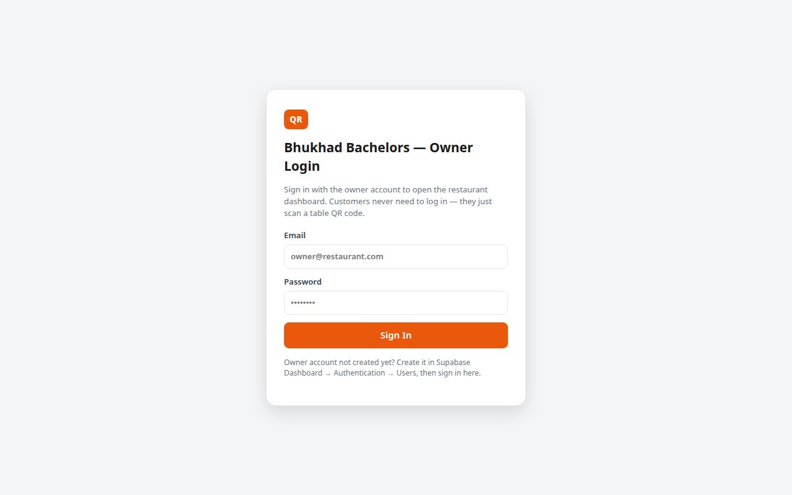

# Bhukhad Bachelors — Restaurant QR Ordering

A fresh, working restaurant QR ordering system for Bhukhad Bachelors, inspired by the QR Mitr demo video
Raj shared — **not** a copy of QR Mitr's code or brand. Built with vanilla
HTML/CSS/JS only. No build step, no framework, no account needed.

## Screenshots


*Customer menu — scan a table QR, browse dishes, add to cart (Bhukhad Bachelors, Table 1).*


*Cart & checkout — name and the 3-digit Table PIN from the table stand confirm the order.*


*Order confirmed — order number, items and total; the waiter brings the food to the table.*


*Owner login — the dashboard is behind a Supabase Auth login. Customers never log in.*

## What it does

- **Owner dashboard** — table grid (10 tables + Lounge Room) with live status
  (Available / Occupied / NEW) and each table's 3-digit PIN on its card, plus a
  live incoming-orders feed. New orders and service requests play a short
  alert chime (WebAudio — no audio file); the Sound button in the header
  turns it off. A new order also pops a **spotlight banner** at the top, the
  KPIs count up as values change, and a **Live Activity** feed lists every
  event (new order, status change, service request, bill settled) with the
  time. **Today's Highlights** show the best-selling dish, busiest table,
  average bill and items served — all computed from today's real orders.
  The header shows a pulsing green **LIVE** dot when the shared database is
  connected (grey "Offline demo" when it is not).
- **Customer QR menu** — scan a table's QR code (or open `index.html?table=1`),
  browse the menu, add dishes, and order. The order is blocked until the
  correct **Table PIN** is entered. Every dish shows a **photo**, the veg /
  non-veg mark, a **spicy level** pill (No spice / Mild / Medium / Hot) and
  **tag** pills (e.g. Bestseller) on a premium card. The menu covers the full
  restaurant: Tandoor Se, Chinese Special, Starters, Main Course, Rice &
  Biryani, Desserts and Drinks & Beverages — 39 dishes. The owner can change
  any dish's photo, spicy level or tags from Menu Management.
- **Orders** — live list, statuses New → Preparing → Served → Paid.
  **Live order tracking:** the customer confirmation page shows a 4-step
  timeline (Order placed → Preparing → Served → Bill settled) with each
  step's real time, updating live with no refresh when the kitchen or
  owner advances the order (Supabase Realtime, or the cross-tab path in
  offline demo mode). A cancelled order shows a clear "Order cancelled"
  state instead. While an order is open, the customer menu shows a
  **Track Order — ORD-XXXX · status** button that opens the same tracking
  view. Timestamps are stored in `qrdine_orders.preparing_at` /
  `served_at` (idempotent `ALTER TABLE` in `supabase-schema.sql`); the
  app still works if those columns do not exist yet, keeping the times
  locally. No ETA is ever invented — only real statuses and real times.
  **One name + one mobile = one active order:** placing an order while
  an open (New / Preparing / Served) order exists with the same name and
  mobile (name trimmed + lowercased, phone digits only, last 10 digits,
  so +91 98765 43210 matches 9876543210) is blocked with "This name and
  mobile already have an open order" and the existing order is shown
  instead. A Paid (settled) order does not block a new order, and an
  empty phone field never blocks (phone stays optional).
  Orders with a phone number get a **WhatsApp** button that opens a chat
  to the customer with the order number and status prefilled. Every order
  also has a **Message** button that opens a real-time **in-app chat** with
  the customer (new table `qrdine_messages`); the customer replies from the
  order-confirmation page, and the owner sees a badge on the order when a
  new customer message arrives.
- **Customer reviews** — once the bill is settled (order status Paid, all 4
  tracking steps done), a review section appears right on the customer's
  confirmation page: tap 1–5 gold stars, an optional comment, name
  prefilled from the order (editable). After submitting, the page shows
  "Thank you for your review!" instead of the form — one review per order,
  so reloading never shows the form again. Reviews are stored in the new
  table `qrdine_reviews` (and locally if the table does not exist yet).
  The owner dashboard has a **Reviews** view listing every review newest
  first (stars, comment, customer, table, order number, date) with the
  average rating and total review count at the top, computed from real
  reviews only — "No reviews yet" when there are none.
- **Kitchen** — New and Preparing orders as big cards with items and
  quantities; one big button moves an order to the next stage
  (New → Preparing → Served).
- **Service requests** — after the Table PIN is entered, the customer menu
  shows Call Waiter / Water / Bill Please / Clean Table buttons. Requests
  appear live on the dashboard with a count badge and a Done button, and
  the customer sees a small confirmation (e.g. "Waiter called").
- **Billing** — pick an occupied table, apply discount (% or ₹) and extra
  charges, choose Cash / UPI / Card, get a **Bill QR** (UPI deep link), then
  Download, send on WhatsApp, or **Print & Settle** (thermal-style receipt via
  the browser print dialog; settling marks the order Paid and frees the table).
  **Split bill** divides the bill between 2–10 people — each person gets
  their own share and UPI QR (the shares add up exactly to the total);
  settling still settles the whole table bill at once.
- **Analytics** — today's revenue, orders, average bill, top-selling items and
  table occupancy, all computed from the real stored orders. Now also an
  **hourly orders bar chart for today** and a **Top Dishes Today** list, both
  from today's real orders; with no orders today they show an honest empty
  state instead of a made-up chart.
- **QR Codes** — one printable QR stand per table. The same menu link also
  works on an **NFC card/tag** — write the link to the tag and a tap opens
  the menu; no app change is needed.
- **Settings** — restaurant name, address, UPI ID, currency. **Reset demo data**
  restores the original demo.
- **Dark theme** — the whole app (customer menu, dashboard, login) is dark
  blue/black with a single orange/red accent and a green Print & Settle
  button, matching the Xtrudeo reel's look. The cart button is red and reads
  "View Order". QR codes keep a white background so scanners can read them.

## Shared database (Supabase) — live on all devices

Orders, tables, menu and settings now live in a **Supabase** project
(`qr-dine-db`, Mumbai region), not in the browser. The owner dashboard
updates live on every device through Supabase Realtime — no refresh.

- **Customer scans a table QR → orders** → the order is saved in Supabase →
  the dashboard on any device shows that table **Occupied** instantly.
- **Owner settles the bill (Print & Settle)** → the order becomes Paid → the
  table turns **Available** on all devices instantly.
- **Owner login:** the dashboard is behind a Supabase Auth login (email +
  password). The customer menu never asks for a login.

### First-time setup (Supabase dashboard)

1. **Create the tables:** Supabase Dashboard → SQL Editor → New query →
   paste `supabase-schema.sql` and Run. It creates `qrdine_tables`,
   `qrdine_menu`, `qrdine_orders`, `qrdine_settings`, `qrdine_requests`,
   grants the anon / authenticated roles table access (without the GRANT
   block every request fails with 42501 "permission denied" and the app falls
   back to offline demo), enables Row Level Security (demo-grade open
   policies — see the comment at the top of the SQL file), enables Realtime
   on all five tables, and seeds the 39-dish starter menu, 11 tables with
   PINs, and the Bhukhad Bachelors settings row.
   (If you already ran an older version of the file without the GRANT
   block, just re-run the current file — it is idempotent.)
2. **Create the owner user:** Authentication → Users → Add user → enter the
   owner's email and a password. That is the login for the dashboard.
   (Confirm the user if email confirmation is on.)
3. **Confirm Realtime:** Database → Replication → check that
   `qrdine_tables`, `qrdine_orders`, `qrdine_menu`, `qrdine_settings` and
   `qrdine_requests` are listed under the `supabase_realtime` publication.
4. Deploy the files (same as before — Vercel / Netlify / static host). No
   build step. The app's Supabase URL and anon key are in `app.js`
   (`SUPABASE_URL`, `SUPABASE_ANON_KEY`).

### Offline fallback

If the Supabase library or project cannot be reached (no internet, CDN
blocked), the app still works in **offline demo mode**: it uses the local
demo data stored in the browser, shows a visible amber banner
("Offline — demo data, not shared across devices"), and the owner login
screen offers a "Continue in offline demo" button. Offline orders are
**not** shared with other devices and are **not** uploaded later — they
stay in that one browser. Reconnect and reload to use the shared database.

### Security notes

- The key in `app.js` is the **anon (publishable) key** — safe to embed in
  a static site. Data is protected by Row Level Security. **Never** put the
  `service_role` (secret) key in the website code.
- The RLS policies in `supabase-schema.sql` are **demo-grade** (anon can
  read/write everything, so login-free customer ordering works). Before real
  production use, tighten them: anon INSERT-only on `qrdine_orders`, SELECT
  on menu/tables, and authenticated-owner-only UPDATE/DELETE.
- The database password was set with Supabase's generator at project
  creation and is not stored anywhere in this repo — reset it in Supabase
  Dashboard → Project Settings → Database if needed.

**Easiest:** double-click `index.html` — it opens in the browser.

**Better (recommended, so QR links work as real URLs):**
```bash
cd qr-dine
python3 -m http.server 8000
```
Then open http://localhost:8000 — dashboard in one tab, customer menu in
another tab (`http://localhost:8000/?table=1`).

## Demo data

- Restaurant: **Bhukhad Bachelors, Bokaro**
- Tables 1–10, PINs **936, 937, 938 … 945** (Table 1 = 936, Table 2 = 937, and
  so on). Lounge Room PIN is **950**.
- Menu: 39 dishes across 7 categories — "Tandoor Se" (Roti ₹15, Butter Roti
  ₹20, naans, Tandoori Chicken), "Chinese Special" (Crispy Baby Corn Chilli
  ₹180 — Chef's Special, Crispy Chilli Mushroom ₹200, noodles, rice,
  Manchurian), Starters, Main Course, Rice & Biryani, Desserts and Drinks &
  Beverages. **These seed dishes are starter data, not the restaurant's real
  menu** — the owner replaces them with his actual dishes, prices and real
  dish photos from Menu Management (name, price, photo URL, spicy level,
  tags). The seed photos are stock photos (Unsplash), each one visually
  checked against its dish (every URL returns HTTP 200); a few are close
  matches rather than the exact dish, so the owner should still replace
  them with real photos of his own dishes. A dish photo that
  fails to load is hidden automatically, never shown as a broken image.
- Payment QR uses the restaurant's real UPI ID **`yaduvanshirajan228@axl`**.
  The Bill QR encodes the exact bill amount — the customer only confirms the
  payment in their UPI app. Bhukhad Bachelors never touches money — the customer's
  UPI app handles the payment.

## Try the full flow

1. Open the dashboard, then open `?table=1` in a second tab (or use the
   "Open Customer View" button and pick Table 1).
2. Add dishes to the cart — try Roti (₹15) + Butter Roti (₹20) + Crispy Baby
   Corn Chilli (₹180) + Crispy Chilli Mushroom (₹200) = ₹415.
3. In the cart, enter a name, then try a **wrong PIN** (e.g. 111) — the order
   is rejected with a clear error.
4. Enter the correct PIN **936** and Confirm Order. Watch the dashboard in
   the other tab: Table 1 turns Occupied and the order appears — no refresh.
5. Billing → pick Table 1 → apply a 10% discount (₹415 → ₹373) → scan the
   Bill QR (it encodes `upi://pay?pa=yaduvanshirajan228@axl&...&am=373`) →
   **Print & Settle**. Table 1 becomes Available again and Analytics shows
   ₹373 revenue. (On the shared database, the Occupied/Available change
   appears on every device instantly; in offline demo mode it only shows in
   that browser.)
6. New in this update: after placing an order, the customer menu shows
   Call Waiter / Water / Bill Please / Clean Table buttons — tap one and it
   appears on the dashboard with a count badge (Done clears it). **Kitchen**
   shows New/Preparing orders with one big advance button. In Billing,
   **Split bill** (e.g. 3 people on a ₹35 bill → ₹12 + ₹12 + ₹11) gives each
   person their own UPI QR. On the Orders list, an order with a phone number
   has a WhatsApp button.

## Deploy free

- **Netlify Drop:** unzip, drag the folder onto https://app.netlify.com/drop
- **Vercel / GitHub Pages / Cloudflare Pages:** upload these files with
  `index.html` at the root. No build step.

## Honest limits

- **Shared sync needs the Supabase tables created** (see above). Until the
  schema is run, the app runs in offline demo mode (per-browser data only).
- The QR library (qrcodejs, MIT licence) is vendored as `qrcode.min.js`, so QR
  codes work fully offline. (The cdnjs CDN loads fine from the shell but is
  blocked inside this environment's browser, so the local copy is used.)
  If the library ever fails to load, QR spots show a text fallback with the
  link instead.
- WhatsApp bill sharing opens `wa.me` with the bill text — the owner sends it
  from their own WhatsApp; no automatic sending without a WhatsApp Business
  API setup.
- The thermal receipt uses the browser's print dialog — connect a thermal
  printer to the billing computer and choose it in the dialog.
